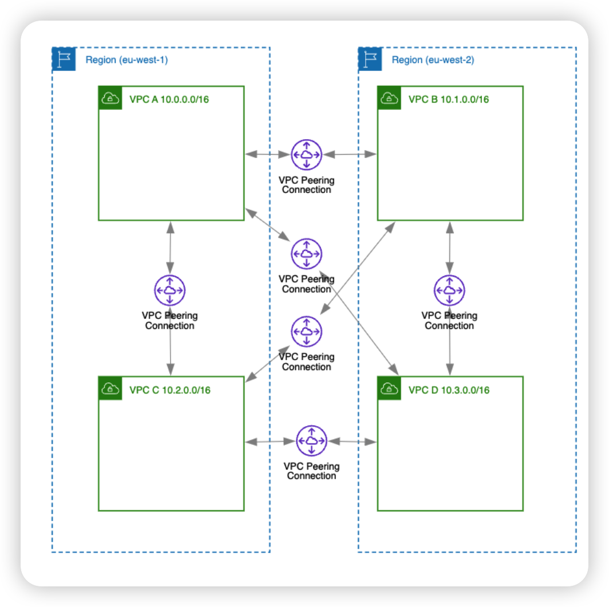
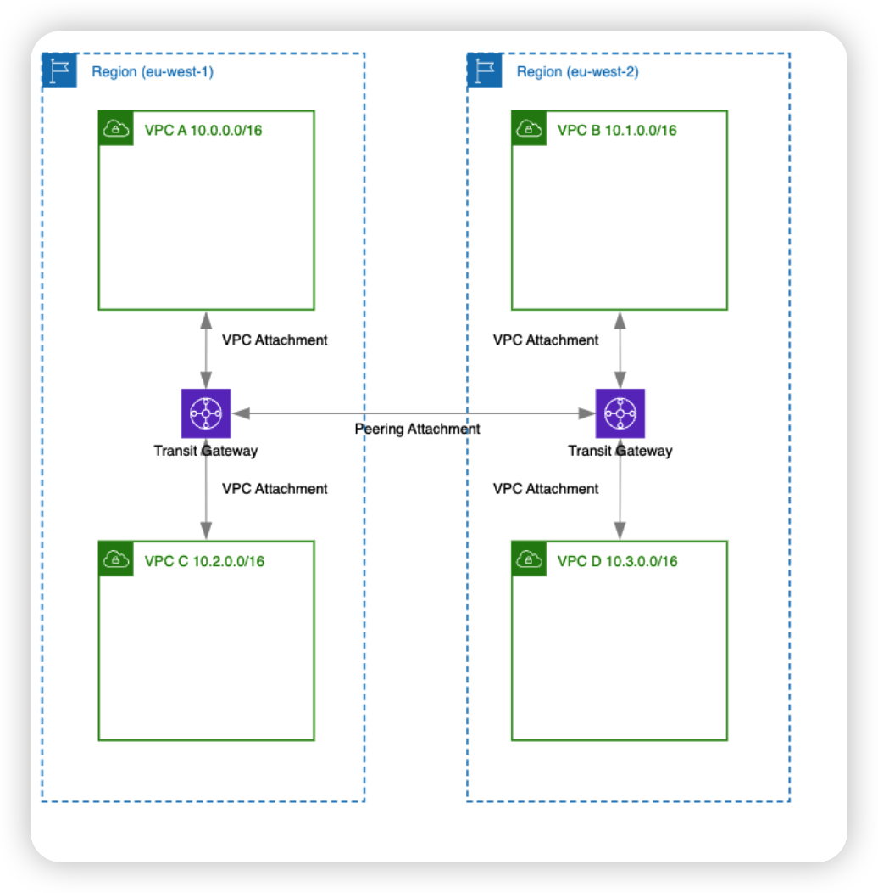
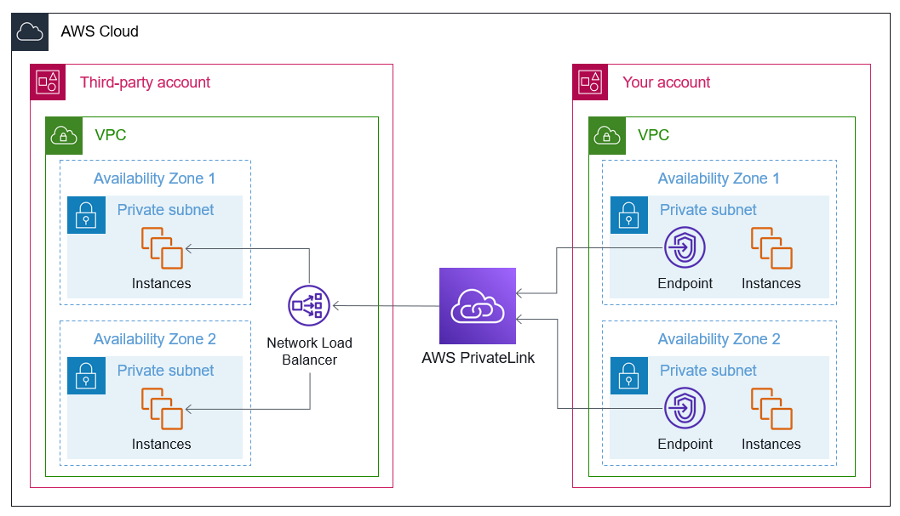
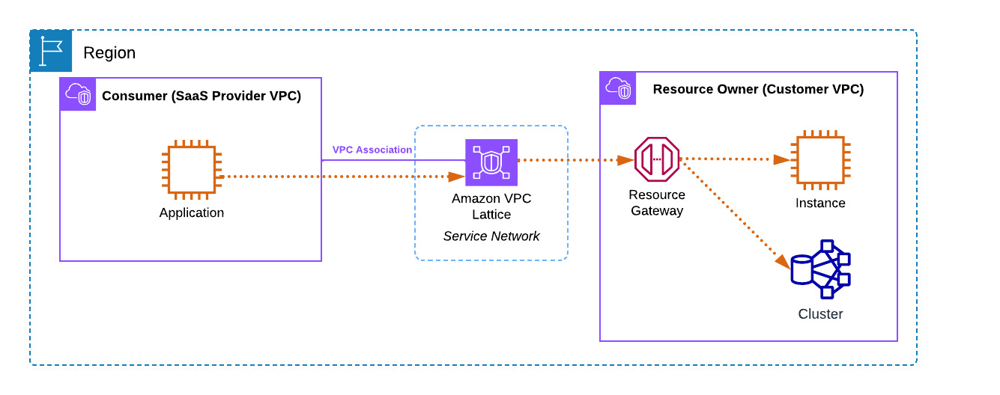
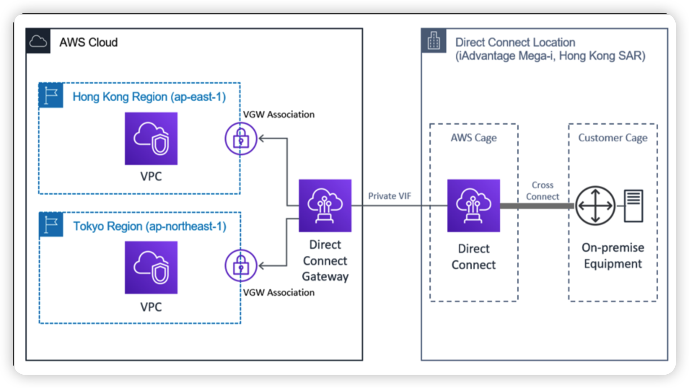

# VPC Connectivity

<!-- @import "[TOC]" {cmd="toc" depthFrom=1 depthTo=6 orderedList=false} -->

<!-- code_chunk_output -->

- [VPC Connectivity](#vpc-connectivity)
    - [Overview](#overview)
      - [1.VPC peering](#1vpc-peering)
      - [2.Transit gateway](#2transit-gateway)
      - [3.PrivateLink (VPC endpoints)](#3privatelink-vpc-endpoints)
        - [(1) Classic PrivateLink](#1-classic-privatelink)
        - [(2) VPC Lattice: Resource Gateway (L4 network endpoint)](#2-vpc-lattice-resource-gateway-l4-network-endpoint)
        - [(3) VPC Lattice: Service Network (L7 network endpoint)](#3-vpc-lattice-service-network-l7-network-endpoint)
      - [4.Resource Access Manager (RAM)](#4resource-access-manager-ram)

<!-- /code_chunk_output -->


### Overview

#### 1.VPC peering
* 1-to-1 connection between two VPCs
* No overlapping IPs allowed



#### 2.Transit gateway
* You "attach" your VPCs to the Transit Gateway (TGW). The TGW handles the routing logic between them.
* No overlapping IPs allowed



#### 3.PrivateLink (VPC endpoints)
PrivateLink connects a Consumer to a specific Service
* VPC Endpoint: The "plug" you create in your VPC
* AWS PrivateLink: The "wiring" inside AWS that makes that plug work and keeps the traffic off the internet

##### (1) Classic PrivateLink
* Endpoint Services: classic PrivateLink provider side
  * Requires an NLB in front of every target service
* Endpoints: classic PrivateLink consumer side



##### (2) VPC Lattice: Resource Gateway (L4 network endpoint) 
* Resource Gateways - The L4 network endpoints that facilitate connectivity
* Resources - The actual AWS resources being shared/accessed
* RAM (Resource Access Manager) - Enables secure sharing of resources across AWS accounts and organizations
* Endpoints: VPC Lattice consumer side



##### (3) VPC Lattice: Service Network (L7 network endpoint) 

#### 4.Resource Access Manager (RAM)

**AWS Resource Access Manager (RAM)** lets you share AWS resources across accounts or within an AWS Organization — without moving or duplicating them.

Common things you can share:
- VPC subnets (consumer deploys into your subnet)
- Transit Gateways (consumer attaches their VPC)
- VPC Lattice Resource Configurations (consumer gets a private endpoint to your RDS/service)
- Route 53 Resolver rules, Aurora clusters, and more

#### 5.Direct Connect (DX)



##### (1) Create DX connection

```tf
resource "aws_dx_connection" "main" {
  name      = "onprem-to-aws-primary"
  bandwidth = "1Gbps"  # Valid dedicated speeds: 1Gbps, 10Gbps, 100Gbps, 400Gbps
  location  = "EqDC2"  # AWS Direct Connect location code (e.g., Equinix Ashburn)

  tags = {
    Environment = "production"
    ManagedBy   = "terraform"
  }
}
```

* AWS assigns a specific port
* AWS generates a PDF document (LOA-CFA)
* You hire a Telecom/Co-location provider to run the cable
* The "Cross-Connect" is plugged in
  * Technicians physically run a fiber optic cable from your router (or your telecom provider’s rack) into the designated AWS patch panel port.

##### (2) Create DX Gateway

```tf
# Create the Direct Connect Gateway
resource "aws_dx_gateway" "main" {
  name            = "main-dx-gateway"
  amazon_side_asn = "64512" # AWS BGP Autonomous System Number (64512-65534 or 4200000000-4294967294)
}

# Connect DX connection with DX Gateway
resource "aws_dx_private_virtual_interface" "vif" {
  connection_id = aws_dx_connection.primary.id
  dx_gateway_id = aws_dx_gateway.main.id

  name           = "private-vif"
  vlan           = 100
  address_family = "ipv4"
  bgp_asn        = 65000
}
```

Setting the ASN (Autonomous System Number) on an aws_dx_gateway is required because AWS Direct Connect uses BGP (Border Gateway Protocol) to dynamically exchange routes between your on-premises routers and AWS.

##### (3) Associate with VPC-side edge gateway

a Virtual Private Gateway (VGW) or a Transit Gateway (TGW)

```tf
# in the same account
resource "aws_dx_gateway_association" "example" {
  dx_gateway_id         = aws_dx_gateway.main.id
  associated_gateway_id = aws_ec2_transit_gateway.example.id # or aws_vpn_gateway.example.id

  allowed_prefixes = [
    "10.0.0.0/16",
    "10.1.0.0/16"
  ]
}
```